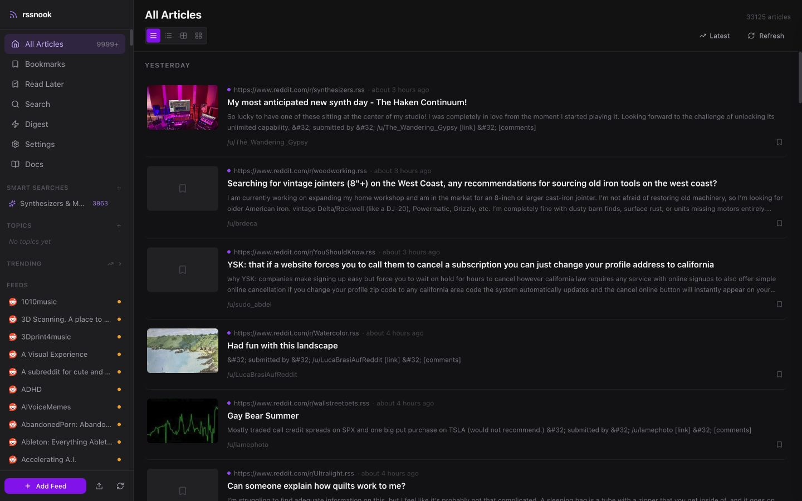

# rssnook

A private, self-hosted RSS reader with full-text extraction, powerful organization, and local AI digests. Your feeds, reading history, notes, and model prompts stay under your control.

[](https://github.com/AdrienLF/rssnook/actions/workflows/ci.yml)
[](LICENSE)
[](https://docs.docker.com/compose/)



## Why rssnook?

rssnook gives you one calm place to follow RSS and Atom feeds, Reddit communities, podcasts, and RSSHub-compatible sources. It fetches readable article content, keeps search and reading state in SQLite, and can use a local Ollama model for summaries and daily digests. There is no hosted account, cloud AI dependency, tracking, or recommendation algorithm.

## Features

- Full-text article extraction with a focused reader view
- Topic and feed organization, drag-and-drop categorization, and OPML import/export
- Read state, bookmarks, Read Later, highlights, private notes, and tags
- Saved smart searches, SQLite FTS5 search, named entities, and trending topics
- Fetch-time automation rules, mute filters, and article-priority signals
- Reddit comment threads and podcast audio playback
- Daily topic digests and on-demand article summaries through local Ollama
- Responsive desktop and mobile layouts with keyboard navigation
- A self-contained Docker Compose deployment with persistent local storage

## Quick start

### Requirements

- Docker with Compose v2
- Enough disk space for the containers and your chosen Ollama model; the default model requires several gigabytes
- An NVIDIA container runtime only if you want GPU acceleration on Linux or WSL2

### Install

```bash
git clone https://github.com/AdrienLF/rssnook.git
cd rssnook

# Start Ollama and download the default model once.
docker compose up -d ollama
docker compose exec ollama ollama pull qwen3.5:9b

# Start rssnook. NVIDIA GPU support is detected automatically.
bash start.sh
```

Open [http://localhost:7755](http://localhost:7755).

On macOS, you can instead double-click `rssnook.command`. It starts Docker Desktop when needed, builds the app, downloads the configured model on first run, and opens rssnook in your browser.

To force CPU mode, run `docker compose up -d`. To stop the application, run `docker compose down`.

## Updating and backups

```bash
git pull --ff-only
docker compose up -d --build
```

Application data lives in `./data`. Back up that directory while rssnook is stopped:

```bash
docker compose down
cp -a data data.backup
```

Ollama models live in the Docker-managed `rssnook_ollama_data` volume and can be downloaded again, so they do not need to be part of an application-data backup.

### Upgrading from earlier releases

The rename is data-safe. On the first start, rssnook stops containers created under the former Compose project name and automatically moves the legacy `rss_reader.db` database to `rssnook.db` when the default database configuration is in use. Existing feeds, articles, settings, and reading history are preserved.

## Adding feeds

Paste a feed or website URL into **Add Feed**. rssnook discovers RSS and Atom links when a regular webpage is provided.

| Source | Example |
|---|---|
| RSS or Atom | `https://example.com/feed.xml` |
| Reddit | `https://www.reddit.com/r/selfhosted` |
| Bluesky through RSSHub | `http://rsshub:1200/bsky/profile/example.com` |
| YouTube through RSSHub | `http://rsshub:1200/youtube/channel/CHANNEL_ID` |
| GitHub releases | `https://github.com/owner/project/releases.atom` |

See the in-app **Docs** page for workflows, keyboard shortcuts, smart searches, and automation examples. RSSHub maintains its full route catalog at [docs.rsshub.app](https://docs.rsshub.app/).

## Configuration

Most settings are editable in **Settings** and persisted in SQLite.

| Setting | Default | Description |
|---|---:|---|
| Digest time | `07:00` | Daily digest generation time |
| Ollama model | `qwen3.5:9b` | Model used for summaries and digests |
| Feed refresh interval | `3600` | Seconds between feed refreshes |
| Article retention | `14` | Days to retain ordinary articles; bookmarked and Read Later items are kept |

Deployment settings can be supplied as environment variables:

| Variable | Default |
|---|---|
| `DATABASE_URL` | `sqlite+aiosqlite:////app/data/rssnook.db` |
| `OLLAMA_BASE_URL` | `http://ollama:11434` |
| `OLLAMA_MODEL` | `qwen3.5:9b` |
| `RSSHUB_BASE_URL` | `http://rsshub:1200` |
| `DIGEST_TIME` | `07:00` |
| `FETCH_INTERVAL` | `3600` |

Copy [`backend/.env.example`](backend/.env.example) when running the backend outside Docker. For Compose deployments, add overrides to the `backend.environment` section or provide an environment-specific Compose override.

## Architecture

| Layer | Technology |
|---|---|
| API and jobs | Python 3.12, FastAPI, SQLAlchemy, APScheduler |
| Web app | SvelteKit 2, Svelte 5, Tailwind CSS |
| Storage and search | SQLite, aiosqlite, FTS5 |
| Article extraction | Trafilatura |
| Local AI | Ollama |
| Feed conversion | RSSHub |
| Deployment | Docker Compose, nginx |

See [ARCHITECTURE.md](ARCHITECTURE.md) for service boundaries, request flows, storage, and extension points.

## Development

### Backend

```bash
cd backend
uv sync --frozen
uv run pytest
uv run uvicorn app.main:app --reload
```

The API and interactive OpenAPI documentation are available at [http://localhost:8000/docs](http://localhost:8000/docs) during local backend development.

### Frontend

```bash
cd frontend
npm ci
npm test
npm run build
npm run dev
```

End-to-end tests expect a running Compose stack:

```bash
cd frontend
BASE_URL=http://localhost:7755 npm run test:e2e
```

## Security model

rssnook is a single-user application with no authentication layer. Run it only on localhost or a trusted private network such as Tailscale; do not expose port 7755 directly to the public internet.

Feed and article HTML is sanitized before rendering, feed targets are validated, containers run the application as non-root users, and nginx adds baseline browser-security headers. Read [SECURITY.md](SECURITY.md) before deploying and use GitHub's private security-advisory form to report vulnerabilities.

## Contributing

Issues and pull requests are welcome. [CONTRIBUTING.md](CONTRIBUTING.md) explains the development workflow and required checks. Participation is governed by the [Code of Conduct](CODE_OF_CONDUCT.md).

## License

rssnook is available under the [MIT License](LICENSE).
